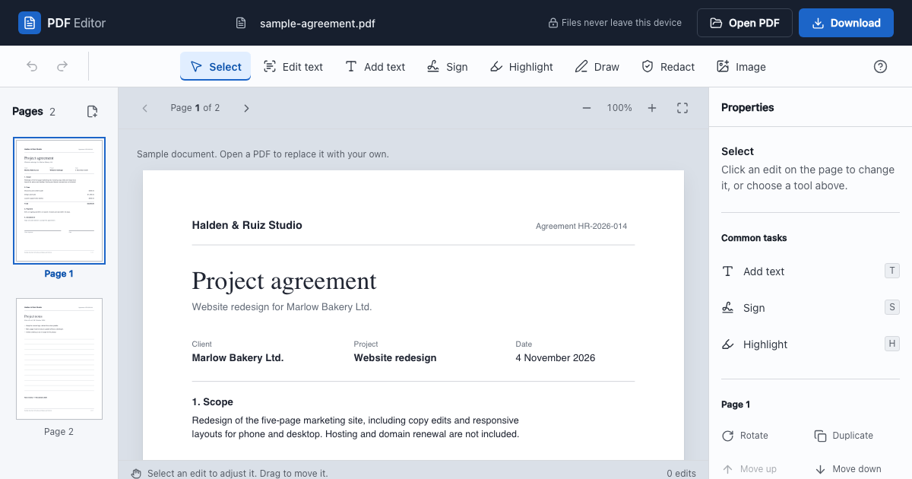

# PDF Editor: free online PDF tools that run in your browser

**Try it: https://firstprayer.github.io/pdf-editor/**

Free PDF editor and PDF tools that work entirely in your browser. Edit, sign,
merge, split, compress, rotate and watermark PDFs, convert JPG to PDF and PDF
to JPG, and add page numbers. Files are processed locally on your device and
never uploaded to a server. No account, no sign-up, no watermark, no install.



## Tools

| Tool | What it does |
| --- | --- |
| [Edit PDF](https://firstprayer.github.io/pdf-editor/) | Full editor: edit text, add text, sign, highlight, draw, redact, insert images, manage pages |
| [Merge PDF](https://firstprayer.github.io/pdf-editor/merge-pdf/) | Join up to 20 PDFs in a chosen order |
| [Split PDF](https://firstprayer.github.io/pdf-editor/split-pdf/) | Every page, page ranges, or selected pages (ZIP when several) |
| [Organize PDF](https://firstprayer.github.io/pdf-editor/organize-pdf/) | Reorder, rotate, copy, delete pages; add pages from other PDFs |
| [Rotate PDF](https://firstprayer.github.io/pdf-editor/rotate-pdf/) | Rotate all or single pages |
| [Compress PDF](https://firstprayer.github.io/pdf-editor/compress-pdf/) | Basic (lossless), Recommended (recompress JPEG photos, keep text), Strong (pages to images) |
| [JPG to PDF](https://firstprayer.github.io/pdf-editor/jpg-to-pdf/) | JPG, PNG, WebP to PDF; A4, Letter or fit-to-image; EXIF rotation respected |
| [PDF to JPG](https://firstprayer.github.io/pdf-editor/pdf-to-jpg/) | Pages to JPG or PNG at 72, 150 or 300 DPI |
| [Add page numbers](https://firstprayer.github.io/pdf-editor/add-page-numbers/) | Six positions, four formats, start number, skip cover |
| [Watermark PDF](https://firstprayer.github.io/pdf-editor/watermark-pdf/) | Text watermark: size, angle, colour, transparency, single or tiled |

## Common questions

**Is it free?** Yes. Every tool is free, with no account, no daily limit and no
watermark on the output.

**Are my files uploaded?** No. Each page opens the PDF or images from your
device, changes them in the browser tab with JavaScript, and downloads a new
file. Nothing is sent to a server. See the [privacy policy](https://firstprayer.github.io/pdf-editor/privacy/).

**Does it work on a phone?** Yes. It runs in any modern browser on desktop or
phone, with nothing to install.

**Can I edit existing text in a PDF?** Yes, for horizontal selectable text.
Limits are listed under [Document behavior and limits](#document-behavior-and-limits).

## How the site is built

`site/catalog.mjs` is the single source for every page: its title,
description, structured data, how-to steps, FAQ and nav label.
`scripts/build-pages.mjs` turns it into `index.html` and `<slug>/index.html`
(committed, so `vite` can serve them) plus `public/sitemap.xml`; `npm run dev`
and `npm run build` run it first, and `npm test` fails if the generated files
are stale. Vite builds each page as its own entry.

Each page has the same static site bar (an ink strip with links to every tool),
then the app, then crawlable copy. Tool apps share `src/tools/ui.jsx` (command
bar, drop zone, page sheets, options panel, live preview) and
`src/tools/ops.js` (pure pdf-lib operations, tested in Node). Browser-only work
such as rendering pages and encoding images lives in `src/tools/browser.js`.

## Run locally

Use Node.js 22.13 or newer (`.nvmrc` pins 24).

```sh
cd pdf-editor
npm ci
npm run dev
```

Open the printed localhost URL, normally `http://127.0.0.1:5184`.
`npm run build` creates the static application in `dist/`;
`npm run preview` serves that build locally. The preparation script copies
PDF.js fonts, character maps, and WebAssembly resources from the pinned npm
package into ignored build inputs. No document is sent to the local server.

## Deployment

Every push to `main` runs `.github/workflows/deploy.yml`: lint, format check,
tests, then `npm run build` with `BASE_PATH=/pdf-editor/`, and publishes `dist/`
to GitHub Pages. The site is fully static; documents never leave the browser.
To build for another host path, set `BASE_PATH` (default `/`).

## Analytics and SEO

The production build loads Google Analytics 4 only on
`firstprayer.github.io/pdf-editor/`, and only when `.env.production` sets
`VITE_GA_MEASUREMENT_ID`. `src/analytics.js` drops query strings and fragments,
keeps referrers to their origin, disables Google signals and ad personalization,
and allows only counts and tool names as event parameters (`pdf_open`,
`pdf_insert`, `tool_select`, `pdf_download` and the matching failure events).
File names, document text, signatures and images are never sent. Local
development never loads analytics.

Tool pages also send `tool_run` and `tool_failed` with `tool`, `pages`,
`files` and `method`. `tool` and `method` are registered as GA4 custom
dimensions (Tool, Tool option).

Every page carries its own title, description, canonical URL, Open Graph and
Twitter cards (`public/og-image.png`), WebApplication, FAQPage and (for tools)
BreadcrumbList structured data, and a static, crawlable guide below the app.
`/privacy/` is the privacy policy, and every footer links to it and the contact
address. Keep it matched to `src/analytics.js`, including the GA4 retention setting.
`public/sitemap.xml` lists every page; it is submitted in Search Console, which
is verified with `public/google3e645556460c9e98.html` (keep that file). To
refresh the share image, capture the running app at 1200×630.

## Editor

- Replace horizontal, selectable original text, or add independent text boxes.
- Draw or type a visual signature and place PNG or JPEG images.
- Highlight, draw, and permanently redact selected page areas.
- Merge PDFs; add blank pages; rotate, reorder, duplicate, and delete pages.
- Select edits with the pointer or the properties selector. Use arrow keys on
  the focused page to move a selection; hold Shift for larger movements.
- Undo and redo the last 50 changes. Download creates a separate edited file.

The editing tools have single-key shortcuts shown in Help. Command/Control S
downloads, Command/Control Z undoes, and Command/Control Shift Z redoes.
The page supports keyboard placement with Enter after choosing an insertion
tool. The original-text dropdown provides a keyboard alternative to clicking
existing text.

## Document behavior and limits

Documents are held in tab memory. Download before closing or refreshing. The
original file on disk is never modified. Imports are limited to 50 MB per PDF,
100 MB combined source files, and 200 pages. Inserted images must be PNG/JPEG,
under 10 MB, and under 40 million pixels.

Ordinary edits preserve original PDF pages and searchable original text. Editing
original text uses a white mask and standard PDF fonts, not original font
reconstruction or paragraph reflow. The affected original page becomes an image;
replacement text remains searchable. Source text with rotation, skew, or reversed
axes is excluded from replacement. Add independent text for those cases.

Redaction creates a new PDF page from sanitized pixels, including existing
annotations. Redaction is applied last. Original text, original image objects,
and underlying annotation text are not copied into the exported redacted page.
All content on that page becomes an image, so its original text and links are
not searchable or interactive. Rasterization uses up to 216 dpi, capped at
16 million pixels and 8,192 pixels per dimension. Other pages keep their original
content. PDF coordinate offsets, rotations, and non-default user units are
preserved through this conversion.

New text uses standard PDF fonts with Latin/Windows-1252 support. OCR,
password-protected PDF decryption, native form-field editing, and
certificate-backed signatures are outside this version. A drawn or typed
signature is a visual mark. Editing an already digitally signed PDF does not
preserve its signature's validity. Review the downloaded document before use.

## Local checks

```sh
npm run test
npm run lint
npm run format:check
npm run build
```

Tests exercise actual PDF generation and independent PDF.js parsing/rendering,
including every tool operation (merge, ranges, split, page assembly and
rotation, page numbers on rotated pages, watermarks, images to PDF, photo
recompression),
including redaction, original-text replacement, signatures, merged page order,
cropped/rotated geometry, and PDF user units. No test uses live documents or
external accounts. Browser acceptance and screenshots are separate checks.

Release QA (real-upload end-to-end tests with fixed input files, screenshots,
hallmark and impeccable review, live GA4 and Search Console checks) is written
up as a skill in `.claude/skills/qa/SKILL.md`, with its scripts beside it.
